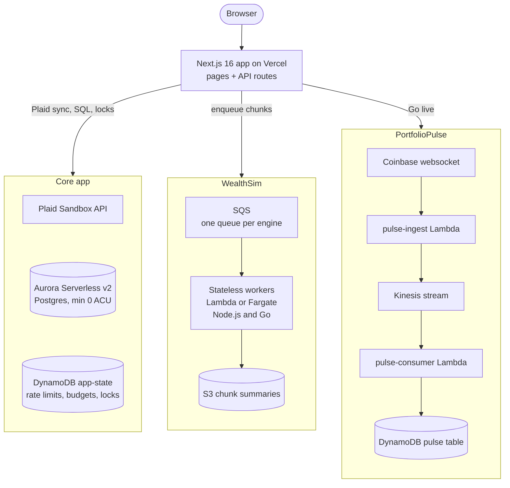
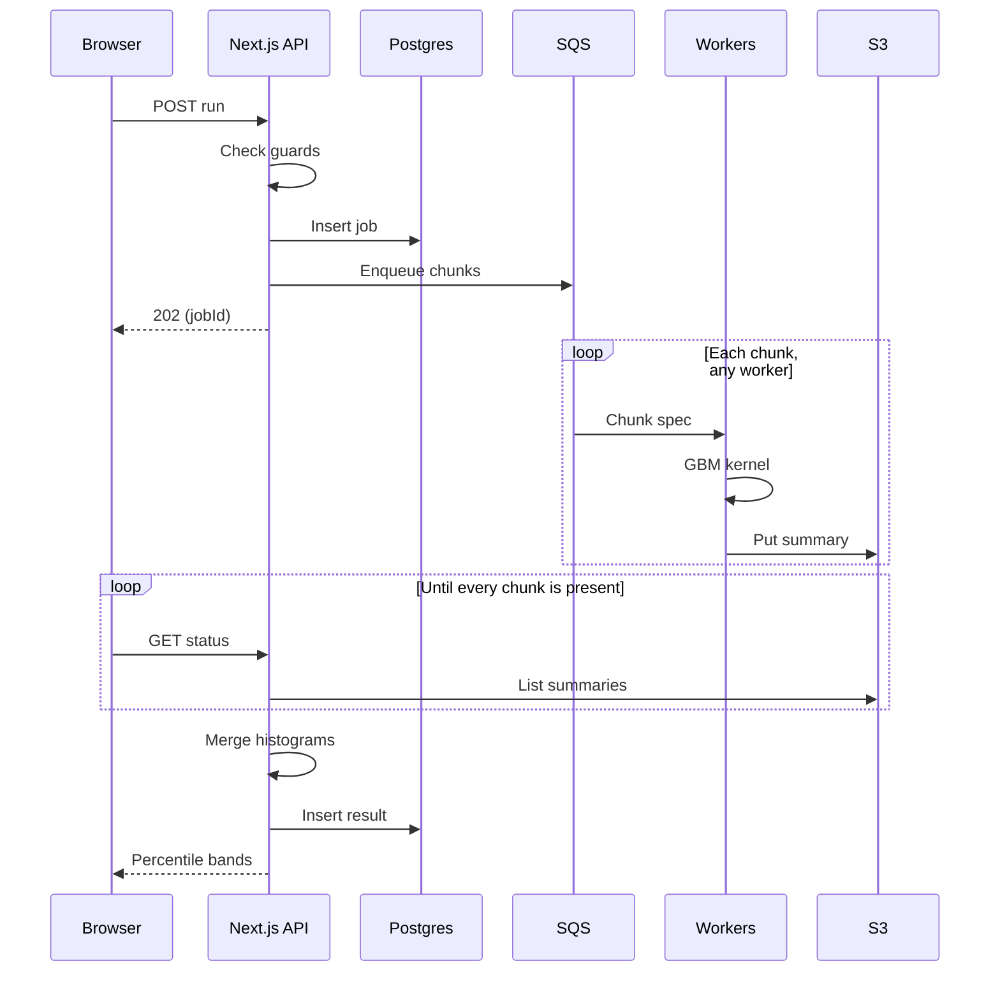
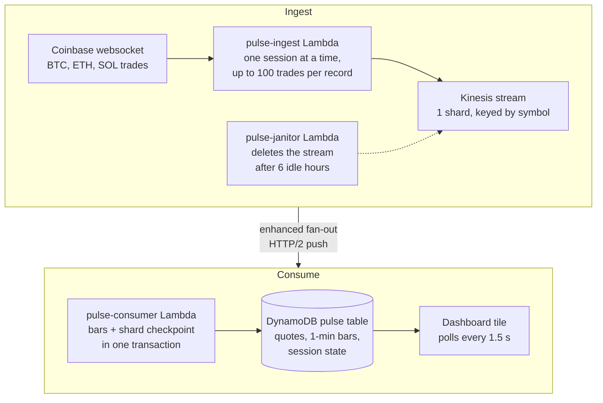
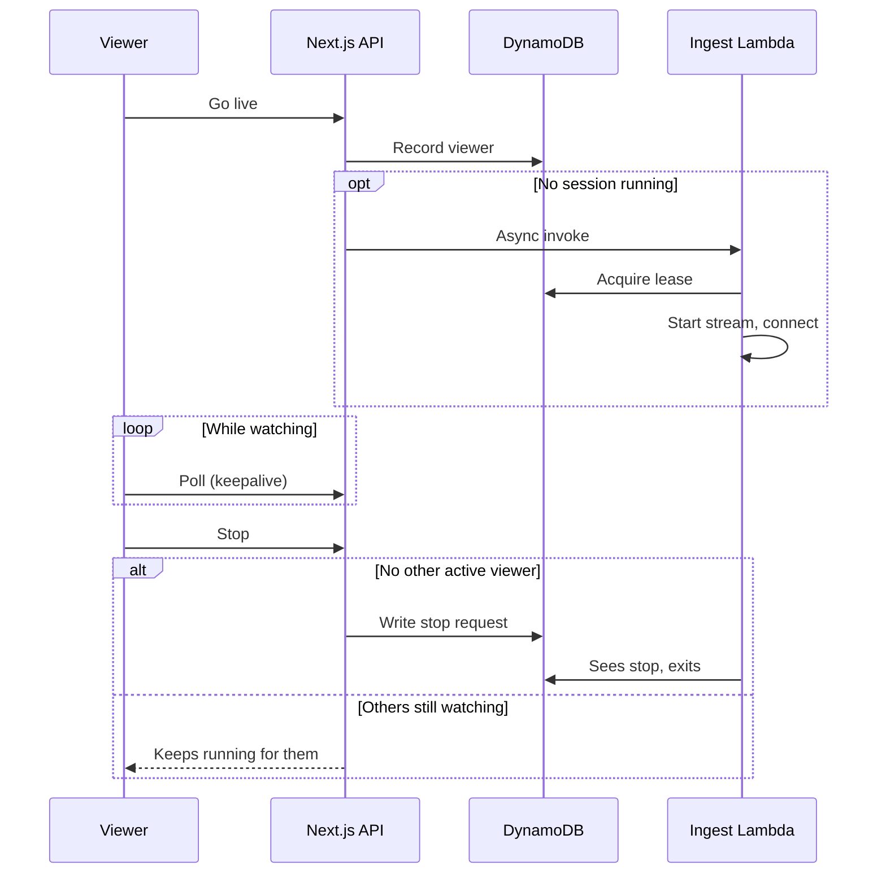

# WealthOS

[](https://github.com/dnguyen-cs/WealthOS---Distributed-Personal-Finance-Platform/actions/workflows/ci.yml)


**A personal finance platform built as a proving ground for cloud-native distributed systems.**

WealthOS links bank accounts through Plaid, projects your net worth forward with a distributed Monte Carlo engine, and streams live crypto prices into a latency-instrumented dashboard.
Underneath, it is three systems sharing one Next.js app: a queue-fed simulation engine with interchangeable Node.js and Go kernels, a scale-to-zero streaming pipeline, and an idempotent bank-sync service.
The AWS side is provisioned with Terraform, and every design claim is backed by a benchmark or a chaos test.

**Live demo: [wealthos.danieln.cloud](https://wealthos.danieln.cloud)**

Register, connect a fake bank with the Plaid Sandbox credentials `user_good` / `pass_good`, then race the two simulation engines or press "Go live" on the market tile.
The first request after a quiet period takes about 14 seconds while the database resumes from zero capacity.

## Contents

- [Highlights](#highlights)
- [What it does](#what-it-does)
- [System architecture](#system-architecture)
- [WealthSim: distributed Monte Carlo](#wealthsim-distributed-monte-carlo)
- [PortfolioPulse: real-time market data](#portfoliopulse-real-time-market-data)
- [Core app: auth and bank sync](#core-app-auth-and-bank-sync)
- [Cost](#cost)
- [Tech stack](#tech-stack)
- [Repository layout](#repository-layout)
- [Getting started](#getting-started)
- [Testing and verification](#testing-and-verification)
- [Deploying to AWS](#deploying-to-aws)
- [Roadmap](#roadmap)

## Highlights

| Result | How |
|---|---|
| **100M Monte Carlo paths in 25.6 s** | 64 Go workers on AWS Batch (Fargate), ~3.91M paths/s, about $0.035 per job all-in |
| **Bit-exact RNG across two languages** | Node.js and Go kernels produce identical random streams; full-pipeline results agree to within 2.5e-15 relative |
| **Idempotency proven under failure** | Killing a worker mid-job still yields byte-identical results, on local emulators and on real Fargate, for both engines |
| **~29x variance reduction** | Antithetic variates cut median-estimator variance ~29x, so the same confidence interval needs ~97% fewer paths |
| **167 ms p50 streaming latency** | Live Coinbase trades from ingest to DynamoDB write, down from 694 ms after moving from shard polling to Kinesis enhanced fan-out |
| **$0 idle compute** | Simulation workers scale to zero, streaming sessions end when nobody is watching, and a daily janitor deletes the idle Kinesis stream |

## What it does

| Module | For the user | Under the hood |
|---|---|---|
| **Core app** | Sign up, link bank accounts, see balances, transactions, and net worth | Auth.js credentials, Plaid `transactions/sync`, encrypted access tokens, DynamoDB sync lease, Aurora Serverless v2 |
| **WealthSim** | Project a portfolio 1 to 60 years out and see median and percentile bands per year; race the Node.js and Go engines on the same seed | Standard SQS fan-out to stateless workers on Lambda or Batch/Fargate, mergeable histograms in S3, aggregation on read |
| **PortfolioPulse** | Watch live BTC, ETH, and SOL prices with 1-minute OHLCV bars and live latency percentiles | On-demand ingest session holding a Coinbase websocket, Kinesis with enhanced fan-out, exactly-once bar merges in DynamoDB |

## System architecture

The app runs on Vercel and talks to AWS through a least-privilege IAM user.
Everything on the AWS side is defined in [`infra/`](infra), except the Kinesis stream, which the ingest creates on demand.



The app also reads back from both compute modules: it aggregates chunk summaries from S3 when a simulation finishes, and the market tile polls the Pulse table.
Simulations from the public site run on scale-to-zero Lambdas, while benchmark fleets run on AWS Batch through separate queues.

Three ideas run through the whole system:

- **Local and cloud run the same code.**
  Every AWS client honors an endpoint override, so ElasticMQ, MinIO, kinesis-mock, and dynamodb-local stand in for SQS, S3, Kinesis, and DynamoDB in `docker compose`.
  There are no code forks between local and AWS; only environment variables change.
- **Correctness by construction, then proof by failure.**
  Idempotency comes from determinism or from transactional checkpoints rather than from hope, and chaos tests kill workers, steal leases, and inject poison records to show it holds.
- **Cost is a design input.**
  Everything that bills by the hour either scales to zero or is torn down, public endpoints are metered by fail-closed guards, and benchmarks report cost alongside speed.

## WealthSim: distributed Monte Carlo

WealthSim projects portfolio value with geometric Brownian motion over monthly steps, with annual contributions, for up to 10 million paths per job.
A job is split into 50,000-path chunks, one SQS message each, and any number of stateless workers process them in any order.
There is no coordinator: the first status read that finds every chunk summary in S3 aggregates them and finalizes the job.



The run endpoint is `POST /api/wealthsim/run` and status reads are `GET /api/wealthsim/jobs/[jobId]`.
Workers are Lambdas for the public demo or Batch tasks on Fargate for benchmarks, each engine on its own queue.

### Design decisions

- **Standard queue, not FIFO.**
  FIFO locks a message group while one message is in flight, so grouping a job's chunks would serialize the fan-out.
  At-least-once delivery is safe because processing is idempotent.
- **Idempotency by determinism, not locks.**
  Each chunk carries a seed for a deterministic PRNG (sfc32) and writes to a deterministic S3 key, so a redelivered message rewrites identical statistics to the same place.
  Workers hold no state at all, which is what lets one container image run under `docker compose`, AWS Batch, and Lambda.
- **Mergeable statistics.**
  Raw paths cannot leave the worker (1M paths over 30 years is gigabytes), and percentiles do not average across workers.
  Each chunk instead records per-year log-binned histograms plus exact moments; histograms with identical bounds merge by element-wise addition, and percentiles read off the merged bins to within ~1.4% of bin width.
- **Lazy, race-safe finalization.**
  Completion is detected on status reads, and a concurrent double-finalize resolves through the unique constraint on `SimulationResult.jobId`.
- **Two engines, one contract.**
  The Go worker in [`go-worker/`](go-worker) is a bit-faithful port of the TypeScript kernel.
  sfc32 and splitmix32 are pure 32-bit integer math, so both runtimes produce bit-identical random streams; PCG64 was rejected because its 128-bit multiplies have no fast JavaScript path.
- **Where cross-language determinism ends.**
  IEEE 754 guarantees correctly rounded add, multiply, divide, and square root, but not `exp` or `log`, so accumulators drift a few ulps between runtimes.
  Reruns on one engine are byte-identical; cross-engine equality is asserted numerically, and measures 2.5e-15 relative end to end.
- **Variance reduction as cost engineering.**
  Paths are generated as antithetic +Z/-Z pairs, which leaves marginal distributions unchanged while sharply reducing estimator variance where the estimator is smooth in the shocks.
  Sharing each draw across a pair also made the kernel ~1.6x faster at equal path count.
- **A liveness rule found by the chaos test.**
  The first AWS chaos run stalled at 39 of 40 chunks: the surviving worker idle-exited after 60 s, before the killed worker's in-flight chunk became visible again at 300 s.
  Nothing was lost, but nothing was left to consume it, so worker idle-exit is now 360 s, above the visibility timeout.
- **Two lanes, chosen by environment.**
  The public demo uses its own queue pair, consumed by scale-to-zero Lambdas (one per engine, 1 full vCPU, capped at 16 concurrent executions), while Batch benchmark fleets use separate queues.
  The app picks a lane purely through `WEALTHSIM_QUEUE_URL` and `WEALTHSIM_QUEUE_URL_GO`, so demo users and benchmarks never contend.
- **Abuse guards that fail closed.**
  The public run endpoint enforces a per-deployment path cap, a per-user runs-per-minute window (429 with `Retry-After`), and a global daily path budget with atomic consume-or-rollback on DynamoDB.
  If the backing store is unreachable, guarded endpoints refuse instead of opening, because they spend real compute.

### Benchmarks

All numbers are measured; raw per-run data lives in [`bench-results/`](bench-results).
Every benchmark run doubled as a determinism check: identical seeds produced byte-identical results across all worker counts and repeats.

**AWS Batch on Fargate**, 1 vCPU and 2 GB per worker, 30-year horizon, mean of 3 seeded runs on a warm fleet:

| Workers | 10M paths, Node.js | 10M paths, Go | 100M paths, Node.js | 100M paths, Go |
|---:|---:|---:|---:|---:|
| 1 | 157.6 s | 145.0 s | | |
| 4 | 43.3 s | 34.9 s | | |
| 8 | 24.1 s | 20.8 s | | |
| 16 | 19.7 s | 12.5 s | 104.4 s (95% efficiency) | 74.5 s |
| 64 | 8.2 s | 7.2 s | 31.8 s (~3.14M paths/s) | **25.6 s (~3.91M paths/s)** |

- 100M paths on 64 Go workers costs ~$0.0225 of compute, or ~$0.035 including S3 and SQS requests; that is 19% faster and 20% cheaper than the Node.js engine.
- 10M paths saturates around 16 workers because fixed submit, enqueue, and aggregate costs dominate; a 10x larger workload restores near-linear scaling.
- On summed kernel time, which cancels out Fargate placement luck, Go is about 21% faster per vCPU (roughly 95K vs 78K paths per compute-second).
- Go's 12.5 MB image (vs 1.2 GB for Node.js) brings fleet cold start down from 48 s to 19-25 s for up to 16 workers.
- The next bottleneck is documented: finalizing a 100M-path job queues ~1,200-1,500 S3 GETs behind the SDK's 50-socket pool.

<details>
<summary>Full scaling tables, local kernel, Lambda lane, and variance study</summary>

**Node.js engine on Fargate**

| Workers | 10M wall | Throughput | Speedup | Cost per 1M paths |
|---:|---:|---:|---:|---:|
| 1 | 157.6 s | ~63K paths/s | x1.00 | ~$0.00022 |
| 2 | 65.6 s | ~152K paths/s | x2.40 | ~$0.00018 |
| 4 | 43.3 s | ~231K paths/s | x3.64 | ~$0.00024 |
| 8 | 24.1 s | ~414K paths/s | x6.53 | ~$0.00027 |
| 16 | 19.7 s | ~519K paths/s | x8.0 | ~$0.0004 |
| 64 | 8.2 s | ~1.21M paths/s | x19.1 | ~$0.0007 |

| Workers | 100M wall | Throughput | Efficiency | Cost per 1M paths |
|---:|---:|---:|---:|---:|
| 16 | 104.4 s | ~959K paths/s | 95% | ~$0.0002 |
| 64 | 31.8 s | ~3.14M paths/s | 78% | ~$0.0003 |

**Go engine on Fargate**

| Workers | 10M wall | Throughput | Speedup | vs Node.js wall |
|---:|---:|---:|---:|---:|
| 1 | 145.0 s | ~69K paths/s | x1.00 | -8% |
| 2 | 72.1 s | ~139K paths/s | x2.01 | +10% |
| 4 | 34.9 s | ~287K paths/s | x4.16 | -19% |
| 8 | 20.8 s | ~480K paths/s | x6.96 | -14% |
| 16 | 12.5 s | ~797K paths/s | x11.6 | -37% |
| 64 | 7.2 s | ~1.40M paths/s | x20.3 | -12% |

| Workers | 100M wall | Throughput | Cost per 1M paths |
|---:|---:|---:|---:|
| 16 | 74.5 s | ~1.34M paths/s | ~$0.00016 |
| 64 | 25.6 s | ~3.91M paths/s | ~$0.00022 |

The superlinear x2.40 at 2 Node.js workers and the per-row swings against Node.js come from Fargate hardware heterogeneity: per-worker throughput ranged +/-20% across fleet placements, while repeats within one fleet varied +/-2%.
Fleet cold start is measured separately: 48 s to 16 running Node.js tasks and 100 s to 64; 19-25 s for 1-16 Go tasks, but 136 s at 64, where Fargate capacity scheduling outweighs image pull.

**Local kernel** (Ryzen 7 9800X3D, 8 cores / 16 threads, antithetic pairing on)

| Setup | Node.js | Go |
|---|---:|---:|
| 1 thread or goroutine | ~166K paths/s | ~175K paths/s (+5%) |
| 8 threads or goroutines | ~865K paths/s | ~1.00M paths/s (+16%) |
| 16 threads or goroutines | ~861K paths/s (no SMT gain) | ~1.24M paths/s (+44%) |

V8's JIT lands within 5% of compiled Go on this floating-point loop single-threaded; Go's advantages are scaling through SMT and a far smaller image.

**Lambda demo lane** (scale-to-zero, capped at 16 concurrent executions per engine)

| Job | Wall time |
|---|---:|
| 2M paths, warm, Node.js | 10.9 s |
| 2M paths, warm, Go | 8.9 s |
| 10M-path burst | 19.5 s |

A 10M-path burst lands within 7 s of a pre-provisioned 16-worker Fargate fleet with zero standing infrastructure.
Short bursts are limited by Lambda's gradual SQS poller ramp (effective parallelism ~3 at 40 chunks, ~6.6 at 200), not by the concurrency cap.

**Variance study** (100 seeded replications of 10K paths, 30-year horizon)

| Estimator | Variance reduction (antithetic vs independent) | Paths saved at equal CI |
|---|---:|---:|
| Median | ~29x | ~97% |
| Mean | ~2.2x | ~55% |
| p90 | ~1.2x | ~17% |
| p10 | ~0.9x | none (within estimation noise) |

Results are reported per statistic because pairing does nothing for extreme quantiles.

</details>

## PortfolioPulse: real-time market data

PortfolioPulse streams live trades for BTC-USD, ETH-USD, and SOL-USD from Coinbase into 1-minute OHLCV bars and a dashboard tile that shows prices alongside the pipeline's own latency percentiles.
The one component a streaming pipeline normally cannot scale to zero is the process holding the websocket, so it runs as an on-demand Lambda session instead of a server.



Sessions start when a viewer presses "Go live" and end when nobody is watching:



"Go live" is `POST /api/pulse/session`, Stop is `DELETE` on the same route, and the tile's `GET /api/pulse` polls double as the viewer keepalive.
The ingest checks for a stop request every 2 seconds, and the lease is a DynamoDB conditional write, so concurrent "Go live" clicks still start only one session.

### Design decisions

- **Sessions, not servers.**
  Any number of viewers pressing "Go live" resolve to exactly one ingest through a DynamoDB lease, and a crashed session's lease expires on its own.
  A session also exits when viewers stop polling or after 15 minutes, and the daily janitor deletes the stream, its fan-out consumer, and the event source mapping, all of which bill hourly whether or not data flows.
- **Bars merge in any order.**
  Open and close are chosen by exchange timestamp rather than arrival order, high and low by max and min, and volume by addition.
  OHLCV bars form a commutative monoid, the same mergeable-statistics discipline as WealthSim's histograms, so replays and reordering cannot scramble a price.
- **Exactly-once on top of at-least-once.**
  The consumer commits a per-shard sequence checkpoint in the same DynamoDB transaction as the bars it covers, so a replayed batch is filtered before it can double-count volume.
  The remaining gap, a producer retry whose reported failure actually landed, is bounded and documented.
- **Push, not poll.**
  A standard Kinesis mapping polls each shard about once per second, which set the floor under the original ~700 ms p50.
  The consumer now reads through an enhanced fan-out consumer that pushes records over HTTP/2 as they land, cutting live p50 from 694 ms to 167 ms.
  The price is ~$0.16 instead of ~$0.11 per live hour: the consumer-hour charge plus ~2.8 smaller consumer invocations per second instead of one.
- **Record packing.**
  A shard accepts 1,000 records/s but 1 MB/s, so packing many trades into each record raises the per-shard ceiling from ~1,386 to ~10,000 events/s.
- **Stop that respects other viewers.**
  Stop means "I am done watching"; the shared session ends only when nobody else is actively polling, so one viewer can never cut off another.

### Measurements

Measured on the live AWS plane; raw runs are in [`bench-results/pulse.jsonl`](bench-results/pulse.jsonl) and [`bench-results/pulse-live.jsonl`](bench-results/pulse-live.jsonl).

| What | Result |
|---|---|
| Live latency, enhanced fan-out (651 trades, AWS clocks on both ends) | p50 167 ms, p90 256 ms, p99 304 ms, max 351 ms |
| Live latency, standard shard polling | p50 694 ms, p99 991 ms |
| Per-shard ceiling, one event per record | ~1,386 events/s |
| Per-shard ceiling, 10-100 events per record | ~10,000 events/s (x7.2) |
| 100K-event backlog after an outage | drained in 1.5 s (~67K events/s) |
| "Go live" to first data | 0.6 s warm; ~90 s cold, when the stream, consumer, and mapping are created |
| Stop to ingest exit | 1.2 s |
| Cost | ~$0.001 per million events; ~$0.16 per live hour; $0 once the janitor tears down |

Latency is measured from ingest to DynamoDB write, the segment this system controls; the exchange-to-ingest leg includes Coinbase's own pipeline and clock skew, so it is reported separately.

## Core app: auth and bank sync

- **Authentication.**
  Auth.js v5 with email and password credentials (bcrypt) and JWT sessions in an httpOnly cookie.
  `src/proxy.ts` redirects signed-out dashboard requests, and every page and route re-checks the session server-side; registration and login are rate-limited per IP.
- **Bank data.**
  Plaid Link in Sandbox mode, then cursor-based `transactions/sync` into Postgres.
  Plaid access tokens are encrypted at rest with AES-256-GCM ([`src/lib/crypto.ts`](src/lib/crypto.ts)).
- **Idempotent sync.**
  A DynamoDB conditional-write lease (token-guarded release, TTL takeover) serializes syncs per bank item, each sync page commits together with its cursor in one database transaction, and upserts key on Plaid's transaction id.
  A crash resumes from the last committed page, and in production a concurrent second sync was turned away by the lease while a re-sync changed 0 rows.
  This is deliberately the opposite mechanism from WealthSim: Plaid's side effects are not replayable, so it needs a lock, while simulation chunks are, so they do not.
- **No Redis.**
  Rate-limit windows, daily budgets, and sync locks all live in one DynamoDB table using conditional writes, which keeps the hosted stack free of always-on infrastructure.
- **Database.**
  Aurora Serverless v2 (Postgres 16) scales to 0 ACU when idle, enforces TLS, and the app pins the RDS certificate authority for full certificate and hostname verification.

## Cost

| Item | Cost |
|---|---|
| Simulation and streaming compute while idle | $0 (the idle stream bills ~$0.03/hour until the daily janitor deletes it) |
| One 100M-path simulation (64 Go workers) | ~$0.035 all-in |
| One live hour of PortfolioPulse | ~$0.16 |
| Hosted deployment, measured monthly total | $8.86 (September 2026), $11.35 (October 2026) |

The monthly floor is mostly Aurora, which pauses at 0 ACU but still wakes about every two hours for its own maintenance and bills each wake for the full five-minute auto-pause window, plus the public IPv4 address the database endpoint needs.
A Route 53 hosted zone adds about $0.50, and a $15 budget alarm guards the account.

## Tech stack

| Layer | Technology |
|---|---|
| Web app | Next.js 16 (App Router), React 19, TypeScript, Tailwind CSS v4, hosted on Vercel |
| Auth | Auth.js v5 credentials provider, bcrypt, JWT sessions |
| Data | PostgreSQL 16 via Prisma 7 (driver adapter) on Aurora Serverless v2; DynamoDB for coordination and streaming state |
| Bank data | Plaid Link and `transactions/sync` (Sandbox) |
| Simulation | Node.js 22 and Go 1.26 workers on SQS, S3, Lambda, and AWS Batch on Fargate |
| Streaming | Coinbase websocket, Kinesis Data Streams with enhanced fan-out, Lambda, EventBridge |
| Infrastructure | Terraform with a versioned S3 backend and native state locking; ECR; CloudWatch alarms to SNS email |
| Local stack | Docker Compose with Postgres, ElasticMQ, MinIO, kinesis-mock, and dynamodb-local |
| CI | GitHub Actions: lint, type check, production build, dependency audit, Go tests, Terraform validation |

## Repository layout

```text
src/
  app/                 Next.js pages and API route handlers
  components/          Dashboard, simulation, and Pulse UI
  lib/
    wealthsim/         Kernel, RNG, histograms, chunking, queue and storage clients, aggregation, guards
    pulse/             Bar merging, session lease, stream and table access
    plaid/             Plaid client, account and transaction sync
    app-state.ts       DynamoDB counters and leases behind rate limits, budgets, and sync locks
  workers/
    wealthsim/         Node.js queue worker and Lambda handler
    pulse/             Ingest, consumer, and janitor Lambdas
go-worker/             Go engine: RNG, kernel, queue worker, Lambda handler, benchmark
infra/                 Terraform for every AWS resource
prisma/                Database schema and migrations
scripts/               Benchmarks, chaos tests, parity and variance studies, Lambda bundling
bench-results/         Raw benchmark data (JSON Lines)
docker/                App and worker images, ElasticMQ config
```

## Getting started

Prerequisites: Node.js 22, pnpm 10, Docker, and a free [Plaid dashboard](https://dashboard.plaid.com) account for Sandbox keys.
Go 1.26 is only needed to work on the Go engine outside Docker.

```bash
cp .env.example .env
# Fill in AUTH_SECRET (openssl rand -base64 32), PLAID_TOKEN_ENC_KEY (openssl rand -hex 32),
# and PLAID_CLIENT_ID / PLAID_SECRET from the Plaid dashboard (Sandbox keys).

pnpm install
docker compose up -d db queue objectstore stream table   # Postgres, SQS, S3, Kinesis, and DynamoDB emulators
docker compose up -d worker worker-go                    # both compute engines (scale with --scale worker=4)
pnpm prisma migrate dev                                  # create the database tables
pnpm dev                                                 # http://localhost:3000
```

Postgres is published on host port 5434 rather than 5432 to avoid clashing with a natively installed Postgres.
`docker compose up` can also build and run the app itself, but on Docker for Windows file changes do not reach the bind mount, so `pnpm dev` on the host is the primary dev loop.
Locally, PortfolioPulse runs by hand with `scripts/pulse-ingest-local.ts` and `scripts/pulse-consumer-local.ts`, which can use a synthetic source instead of the live Coinbase feed.

Then, in the browser:

1. Register at `/register`, which signs you in and opens the dashboard.
2. Click "Connect a bank", pick any institution, and sign in with `user_good` / `pass_good`.
3. Accounts and transactions sync into Postgres; "Sync" runs an incremental `transactions/sync`.
4. Open "Simulations", set your assumptions, pick an engine, and run a projection; the fan chart shows the median and percentile bands per year.
5. Or click "Race both engines": the same seed runs on Node.js and Go side by side, and a badge reports the measured divergence between the two results.

## Testing and verification

CI runs lint, a type check, a production build, a production dependency audit, the Go test suite, and Terraform format and validation on every push.
The heavier proofs below run against the local stack or real AWS.
Scripts run with `pnpm exec tsx scripts/<name>.ts`.

| Command or script | What it proves |
|---|---|
| `pnpm test` | Vitest suite (run locally): kernel determinism, GBM closed forms, histogram accuracy, merge exactness, variance reduction, bar merging |
| `go test ./...` in `go-worker/` | Go RNG streams are bit-exact against vectors generated from the Node.js kernel; golden summaries and closed forms |
| `pnpm bench`, `go run ./cmd/bench` | Local single-machine kernel throughput for each engine |
| `parity-test.ts` | Same seed through the full pipeline on both engines: Go reruns are byte-identical, cross-engine divergence stays within tolerance |
| `chaos-test.ts` | Kill a worker mid-job, wait for redelivery, and assert byte-identical results against a control run (`ENGINE=go` for the Go fleet) |
| `chaos-test-aws.ts` | The same proof with real Fargate task termination |
| `variance-test.ts` | Antithetic vs independent sampling, per estimator |
| `bench-aws.ts` | Fargate scaling curve (`ENGINE`, `WORKERS`, `PATHS_LIST`, `REPEATS`) |
| `bench-pulse.ts` | Pulse throughput, latency, and backlog-drain benchmarks against the live stream |

After changing the kernel, regenerate the cross-engine vectors with `gen-parity-vectors.ts`.

## Deploying to AWS

Terraform in [`infra/`](infra) provisions the whole AWS side: public subnets with no NAT gateway, per-engine SQS queues with dead-letter queues, the S3 results bucket with a 30-day lifecycle, ECR repositories, the Batch compute environment and job definitions, the demo and Pulse Lambdas, DynamoDB tables, Aurora, least-privilege IAM, CloudWatch alarms that email on any dead-letter message, and a monthly budget alarm.
The Kinesis stream and its consumer are deliberately not in Terraform, because the ingest creates them on demand and the janitor deletes them.

```bash
pnpm build:lambdas                       # bundle the Node.js and Go Lambda zips into dist/lambda/
cd infra && terraform init && terraform plan -out=tfplan && terraform apply tfplan
```

The state backend in `infra/terraform.tf` points at this project's own bucket; change it before applying to another account.
To run Batch benchmark fleets, build `docker/Dockerfile.worker` and `docker/Dockerfile.worker-go` for `linux/amd64`, push them to the ECR repositories from the Terraform outputs, and drive jobs with `scripts/run-aws-job.ts` or `scripts/bench-aws.ts`.
The hosted app needs the same environment as `.env.example`, minus the `*_ENDPOINT` overrides, pointed at the Terraform outputs.

## Roadmap

- **Push Pulse updates to the browser.**
  The pipeline is at 167 ms p50, but the tile still polls every 1.5 s; server-sent events or WebSockets would make glass-to-glass latency the headline number.
- **Goal planning on WealthSim.**
  Answer "Will I reach $X by year Y?" with contributions and withdrawals over time, inflation-adjusted output, and sequence-of-returns risk.
- **Faster large-job finalization.**
  Streaming, bounded-concurrency aggregation would remove the S3 GET queue behind 100M-path jobs.
- **Cost guardrails in CI.**
  Infracost on Terraform changes, and OIDC-based deploys instead of applying from a laptop.
- **Real bank accounts.**
  In order: KMS envelope encryption for Plaid tokens, Plaid production access, webhook-driven sync with signature verification, and a data deletion path.
